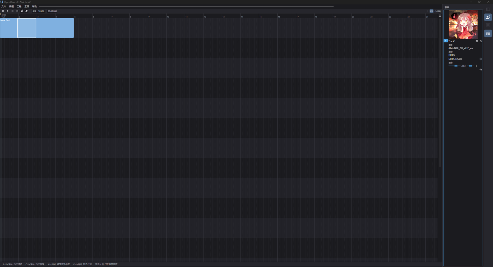
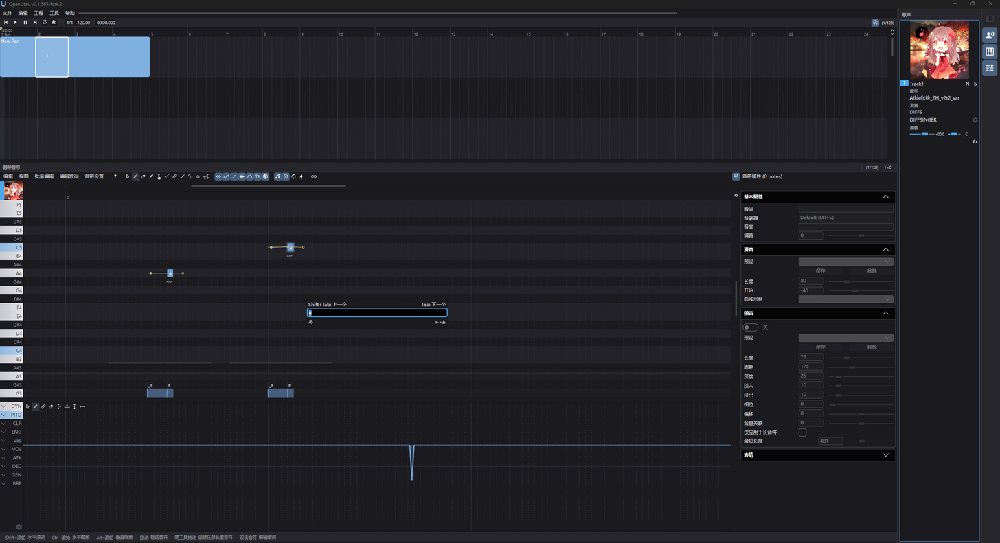
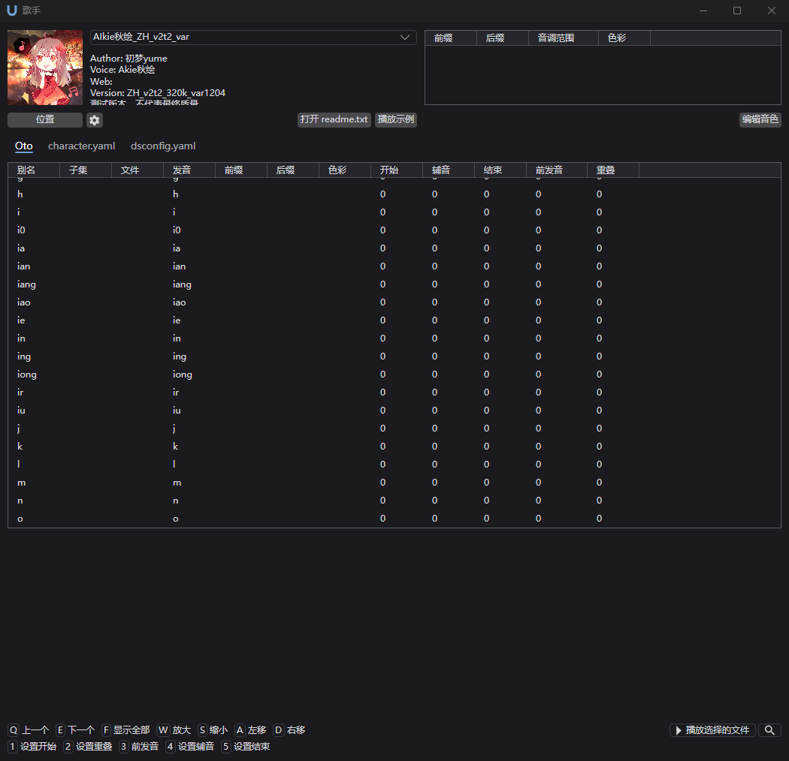

# OpenUtau — 增强分支 · HuanMoovo Enhancement Fork

<p align="center">
  
</p>

**English** · [简体中文](README.zh-CN.md)

[](https://github.com/HuanMoovo/OpenUtau/releases/tag/v0.1.565-fork.2)
[](LICENSE.txt)
[](https://github.com/openutau/OpenUtau)

> **This repository is a fork — an enhancement branch of [openutau/OpenUtau](https://github.com/openutau/OpenUtau). It is not the upstream repository.**
>
> 本仓库是 OpenUtau 的**增强分支**：在上游 MIT 许可与原有功能之上，做了性能优化、Synthesizer V 风格界面改版、歌手模型图（立绘）自动识别和一批 BUG 修复。中文说明见 **[README.zh-CN.md](README.zh-CN.md)**。

## What is this branch? / 本分支是什么

- An **enhancement branch** of OpenUtau tracking **upstream `master`**. This fork's `master` is currently **29 commits ahead** of upstream ([compare](https://github.com/HuanMoovo/OpenUtau/compare/13184085f2cee51c174de9ee99163a76ee970e8c...master)).
- **MIT licensed**, same as upstream — see `LICENSE.txt` (© StAkira / OpenUtau contributors). **No upstream code has been removed**; upstream's original README is kept unchanged at the bottom of this page.
- Scope: performance of large projects, a Synthesizer V Studio–style black-gray default UI, singer portrait auto-detection, and fixes for bugs tracked upstream.

## Highlights

### ⚡ 性能 · Performance
- **TimeAxis segment lookup** rewritten to a keyword array + binary search — measured **4.8×–35.5× faster** on a 4096-segment project; small projects unchanged.
- **Parallel render**: the built-in Worldline resampler renders phrases multi-threaded with a configurable thread budget (behind a capability flag; DiffSinger / Classic stay serial for safety).
- **Flat row-major buffers** replace per-frame NumSharp work in `SynthFeatures`, the speaker-embedding curves and the resampler frame path.
- **Piano-roll redraw and snap lines**: no per-frame geometry allocation, and snapping uses an immutable snapshot — correct even before the first paint.
- **Render / audio allocation cleanup**: SDL3 buffer reuse, incremental `MixPlanner` rebuild, memoised staging and voicebank loading, binary search in the English VCCV phonemizer.

### 🎨 界面与交互 · UI & Interaction
- A **Synthesizer V Studio–style black-gray DEFAULT theme** with a soft-blue accent (`#6E9FD4` / `#7FB0E0`), plus a redesigned logo and all shipped icon / icns / png assets.
- **Modernised workspace layout**: one compact toolbar row; 编排 / 钢琴卷帘 / 歌声 panel captions; a right-hand 歌声 inspector with the singer model-image banner; a far-right 48px icon strip toggling the voice column / piano-roll pane / note-params pane; a bottom mouse-gesture hint strip that lights up with the modifier you hold.
- **Tempo-marker dragging** on both timelines: snap preview, a single undo group, Esc / leaving the marker cancels.
- **Configurable global hotkeys** with a Preferences page — duplicate or invalid gestures are rejected, and menus show the bound gesture.
- **Singer workflow**: a delete-singer action in the singers dialog, a compact singer selector, and **portrait auto-detection** (`character.yaml portrait:` → `portrait.*` → `character.*` → `立绘.*` → the bank's own icon) so installed voicebanks show their model image without editing `character.yaml`.

### 🐞 修复 · Bug fixes
- Upstream-tracker fixes: **stale PCM** after switching singer or editing notes; a **NaN `TimeSpan`** from degenerate tempo; **pitch-array OOM** on absurd note lengths; **multichannel wave parts failing to load**; **out-of-range skip/trim** crashing playback.
- The test suites grew from **643 → 768** (Core) and **10 → 46** (UI) — the UI suite is a headless Avalonia harness that drives real pointer / key events and saves screenshots.

## Screenshots


**Editor** — one compact toolbar row, the 编排 track list on the left, the 歌声 inspector with the singer model-image banner on the right, and the far-right icon strip.


**Piano roll** — a part opened in the roll, with the note-editing toolbar and expression lanes.


**Singers** — the 歌手 dialog: a DiffSinger voicebank's model image, metadata and phoneme table.

**Brand assets:** [brand sheet](docs/brand/brand-sheet-dark.png) · mark [`Logo/openutau.svg`](Logo/openutau.svg) · logotype [`Logo/openutau_logotype.svg`](Logo/openutau_logotype.svg)

## Download & install

[](https://github.com/HuanMoovo/OpenUtau/releases/tag/v0.1.565-fork.2)

Latest fork release: **[v0.1.565-fork.2](https://github.com/HuanMoovo/OpenUtau/releases/tag/v0.1.565-fork.2)** → `OpenUtau-fork-win-x64-v2.zip` (≈168 MB)

1. **Download** the zip from the release page and **unpack** it anywhere (e.g. `D:\OpenUtau`).
2. **Run `OpenUtau.exe`** — this is a **self-contained Windows x64 build**: the .NET runtime is bundled, nothing else to install (Windows 10 / 11 x64).
3. **Install voicebanks**: put each voicebank folder into the `Singers` folder next to `OpenUtau.exe` (e.g. `<unpacked folder>\Singers\<your voicebank>`); it is created on first launch. Restart the app to see them.
4. **On first run the app defaults to the new black-gray theme.** Themes can be switched in Preferences.

Only the Windows x64 release is published for this fork; no other platform is built or verified here.

## Build & test from source

Requires the **.NET SDK for .NET 10** (target `net10.0-windows`):

```bash
git clone https://github.com/HuanMoovo/OpenUtau.git
cd OpenUtau

# Build the app (Debug is the default and what the test suites run against)
dotnet build OpenUtau/OpenUtau.csproj

# Core tests: 768 pass, 2 skipped (live tests)
dotnet run --project OpenUtau.Test/OpenUtau.Test.csproj

# Headless UI tests: 46 pass
dotnet run --project OpenUtau.UiTest/OpenUtau.UiTest.csproj
```

Note: the suites use xunit v3 on Microsoft.Testing.Platform — `dotnet test --filter` does not work here; run the whole project instead (runner arguments go after `--`).

## Relationship to upstream

- Built on [openutau/OpenUtau](https://github.com/openutau/OpenUtau) `master`; this fork's `master` is **29 commits ahead**, and **no upstream code was removed** — upstream's original README is kept unchanged at the bottom of this page.
- **MIT License**, unchanged (`LICENSE.txt`, © StAkira / OpenUtau contributors). All fork changes are released under the same license.
- Sync with upstream like any fork:

```bash
git clone https://github.com/HuanMoovo/OpenUtau.git
cd OpenUtau
git remote add upstream https://github.com/openutau/OpenUtau.git
git fetch upstream
git merge upstream/master
```

## Credits

OpenUtau itself — the editor, the resamplers, the phonemizers, the plugin system, the translations — is the work of **[StAkira](https://github.com/stakira) and the OpenUtau contributors**; this fork only builds on top of it. Thank you to the upstream project and community ([Discord](https://discord.gg/UfpMnqMmEM) · [Wiki](https://github.com/openutau/OpenUtau/wiki) · [中文使用说明](https://opensynth.miraheze.org/wiki/OpenUTAU/%E4%BD%BF%E7%94%A8%E6%96%B9%E6%B3%95)). Fork changes are maintained by [HuanMoovo](https://github.com/HuanMoovo).

---

*以下为上游原版 README 的完整内容（未改动）。The section below is the original upstream README, kept unchanged — its badges, title, links and all credits are intact.*

# OpenUtau

OpenUtau is a free, open-source editor made for the UTAU community.

[](https://github.com/stakira/OpenUtau/actions/workflows/build.yml)
[](https://discord.gg/UfpMnqMmEM)
[](https://qm.qq.com/cgi-bin/qm/qr?k=8EtEpehB1a-nfTNAnngTVqX3o9xoIxmT&jump_from=webapi)
[](https://trello.com/b/93ANoCIV/openutau)

## Getting started

[](https://github.com/stakira/OpenUtau/releases/latest/download/OpenUtau-win-x64.zip)</br>
[](https://github.com/stakira/OpenUtau/releases/latest/download/OpenUtau-linux-x64.zip)

It is **strongly recommended** that you read these Github wiki pages before using the software.
- [Getting-Started](https://github.com/stakira/OpenUtau/wiki/Getting-Started)
- [Resamplers](https://github.com/stakira/OpenUtau/wiki/Resamplers-and-Wavtools)
- [Phonemizers](https://github.com/stakira/OpenUtau/wiki/Phonemizers)
- [FAQ](https://github.com/stakira/OpenUtau/wiki/FAQ)

- [中文使用说明](https://opensynth.miraheze.org/wiki/OpenUTAU/%E4%BD%BF%E7%94%A8%E6%96%B9%E6%B3%95)

## How to contribute

Tried OpenUtau and not satisfied? Don't just walk away! You can help:
- Report issues on our [Discord server](https://discord.gg/UfpMnqMmEM) or Github.
- Suggest features on Discord or Github.
- Add or update translations for your language on [Crowdin](https://crowdin.com/project/oxygen-dioxideopenutau).

Know how to code? Got an idea for an improvement? Don't keep it to yourself!
- Contribute fixes via pull requests.
- Check out the development roadmap on [Trello](https://trello.com/b/93ANoCIV/openutau) and discuss it on Discord.

## Plugin development

Want to contribute plugins to help other users? Check out our API documentation:
- [Editing Macros API Document](OpenUtau.Core/Editing/README.md)
- [Phonemizers API Document](OpenUtau.Core/Api/README.md)

## Main features

Navigate the interface naturally and fluently using the mouse and scroll wheel. Keyboard shortcuts are also available.


Easily create songs and covers using the feature-rich MIDI editor.


Create expressive vibratos with the easy-to-use vibrato editor.


Pre-rendering and built-in resamplers let you quickly preview your work.


See the [Getting-Started Wiki page](https://github.com/stakira/OpenUtau/wiki/Getting-Started) for more!

## All features
- Modern user experience.
- Easy navigation using the mouse and keyboard.
- Feature-rich MIDI editor.
  - Support for importing VSQX (Vocaloid 4) tracks.
- Selective backward compatibility with UTAU.
  - OpenUtau aims to solve problems with fewer steps. It is not designed to replicate UTAU features exactly.
- Extensible real-time phonetic editing.
  - Includes phonemizers for different phonetic systems (VCV, CVVC, Arpasing, etc.) in many different languages (English, Japanese, Chinese, Korean, Russian and more).
- Expressions replace the standard UTAU "flags" for tuning.
  - The built-in WORLDLINE-R resampler supports curve tuning, similar to many vocal synth editors.
- Internationalisation, including UI translation and file system encoding support.
  - Unlike UTAU, there is no need to change your system locale to use OpenUtau.
- Smooth preview/rendering experience.
  - Pre-rendering allows OpenUtau to render vocals before playback, saving time during editing and tuning.
- Supports ENUNU AI singers. See the [ENUNU wiki page](https://github.com/stakira/OpenUtau/wiki/ENUNU-NNSVS-Support) for more info.
- Easy-to-use plugin system.
- Versatile resampling engine interface.
  - Compatible with most UTAU resamplers.
- Runs on Windows (32/64 bit), macOS, and Linux.

### What it doesn't do
- While OpenUtau can do very minimal mixing, it will not replace your digital audio workstation of choice.
- OpenUtau does not aim for Vocaloid compatibility, except for some limited features.
